# FinData Provider Portal — Training Manual for Insurance Companies

**Filing your §29 return with the Kano State Internal Revenue Service (KIRS), from first sign-in to receipt.**

This manual trains the staff of an insurance company to file returns with the **Kano State
Internal Revenue Service (KIRS)** through the FinData provider portal. It is written for the people who prepare the data (compliance, finance,
policy administration and IT) and for the person who signs in to submit it. It is also the
trainer's script: Part 0 sets out a session plan, and Appendix B supplies practice files.

> **About the screens in this manual.** Every screen was captured from a training
> installation. **Sentinel Assurance Plc is an invented insurer**, and every policyholder,
> policy number, identifier and amount shown is invented. No real person or company appears
> anywhere in this document. The screens, rules and messages are the live product, set up
> with KIRS's name and logo.

---

## Part 0 — For the trainer

### Who this training is for

| Role in the insurer | What they need from the portal |
|---|---|
| **Compliance officer** | Understand the obligation, the calendar and the penalties; sign in and file |
| **Finance / policy-administration analyst** | Extract the data and build the return file correctly |
| **IT / data officer** | Produce the file from the policy system; understand every rejection message |
| **Head of compliance** | Know what a receipt proves and what to do when something goes wrong |

Every portal user can do everything the portal offers: the role shown on the Profile page
(Provider Admin, Compliance Officer, Data Operator) is a label, and no screen is restricted
by it. Decide inside your company who files.

### Suggested session plan (about three hours)

| Module | Topic | Manual | Hands-on |
|---|---|---|---|
| 1 | The obligation, and what the return contains | Part 1 | Read the §29(1) text together |
| 2 | Account, sign-in, passwords, sessions | Part 2 | Everyone signs in and finds Profile |
| 3 | The dashboard: calendar, due dates, penalties | Part 3 | Find the next due return and its due date |
| 4 | Preparing the return file | Part 4 | Open `good-q3.csv`; spot the rules |
| 5 | Filing with the IRIS Upload Assistant | Part 5 | File `messy-q3.csv`, then `good-q3.csv` |
| 6 | Reading a rejection and correcting it | Part 6 | Upload `bad-q3.csv`; fix every error |
| 7 | Deadlines, penalties, notifications, security | Parts 7–9 | Quiz: Appendix A |

The practice files are in Appendix B and in the folder `docs/manual-training-files/`. Use a
**training installation** for the exercises, never the live portal: a return that is
accepted in the live portal is final for that period.

---

## Part 1 — Your obligation

### What the law requires

Section 29(1) of the Nigeria Tax Administration Act 2025 names insurance companies
expressly:

> "…every bank, insurance company, stock-broking firm, or any other financial institution,
> shall prepare, with or without demand by the Service, annual returns specifying the names,
> customer location and transactions of new and existing customers in the case of —
> (a) an individual, where the cumulative transactions in a month amount to ₦50,000,000.00
> or more; or (b) a body corporate, where the cumulative transactions in a month amount to
> ₦250,000,000.00 or more."

| Provision | What it means for you |
|---|---|
| **NTAA 2025 s.29(1)** | You must prepare a return on each customer whose cumulative transactions in a month reach ₦50 million (an individual) or ₦250 million (a body corporate) |
| **s.29(2)–(3)** | The relevant tax authority may, by notice, rules, regulations, guidelines or circulars, prescribe further returns, and may require any person, including a bank, to provide information by notice |
| **s.101** | A taxable person who fails or refuses to file returns, or knowingly files incomplete or inaccurate returns, is liable to an administrative penalty of **₦100,000 in the first month** in which the failure occurs and **₦50,000 for each subsequent month** in which it continues |
| **s.142 and s.143** | Taxpayer information is confidential, and every person who has access to it must treat it as secret — this binds KIRS's own staff |

For a State, the "relevant tax authority" is the State's own Internal Revenue Service —
section 147 of the Act defines it to include the Internal Revenue Service of a State — so
**KIRS is the authority to which you file**. FinData is the system through which KIRS receives
these returns. The Act describes an annual return; **KIRS sets the reporting frequency for your
institution**, and the portal shows it on your Profile page (quarterly unless KIRS has set
otherwise). Everything in this manual follows that setting.

### What you send

You file **one return per reporting period**. A return is one file, with **one row per
policy**, carrying the eight columns in Part 4.

- FinData **does not filter your file by amount.** Every valid row you send is accepted and
  stored. The ₦50 million and ₦250 million thresholds in s.29(1) decide which customers the
  Act requires you to report; the portal does not apply them for you, so apply them when
  you extract the data.
- Each **policy number may appear only once per period**, in one return.
- The return carries identifiers (NIN and BVN) because FinData matches each row to the
  taxpayer register. Those identifiers are encrypted when they arrive, and the portal only
  ever shows them masked (Part 9).

---

## Part 2 — Getting access

### Your account

KIRS creates your portal user. **No password is ever issued.** You receive
an **invitation link**: open it, choose your own password, and use the account. The link
works **once** and expires after **seven days**; if it expires, ask KIRS to issue
a new one. Nobody at KIRS can see the password you choose.

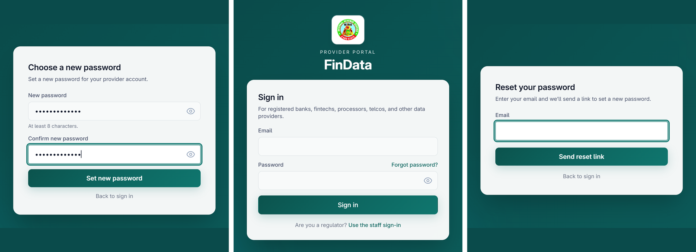

The invitation reads: *"An account has been created for you to file your institution's returns to the Kano State Internal Revenue Service. Open the link and choose your own password. It can be used once and expires on the date stated. … We never send passwords, and no one at the Revenue Service can see yours. Please do not forward this link to anyone."* Whoever opens the link first sets the password.

### Signing in

Go to the portal address KIRS gave you; the sign-in page is at `/provider/login`.

Enter your e-mail address and password and press **Sign in**. A wrong e-mail address, a wrong
password and a deactivated account all give the same message — **Invalid credentials** — so
the portal never reveals which of them applies.

### Passwords

- A password must be **at least eight characters**. Use a long passphrase that you do not use
  anywhere else.
- **Forgot your password?** Press the link on the sign-in page, enter your e-mail address and
  press **Send reset link**. The page always answers *"If an account exists for that email, a
  reset link is on its way. The link expires in 1 hour."*, whether or not the address is
  registered.

- To change your password while signed in, open **Profile → Change password**, enter the
  current password, then the new one twice.
- **A password change ends your session.** After *"Password updated."* the portal will send
  you back to the sign-in page; sign in again with the new password.

### How long you stay signed in

A sign-in lasts **24 hours** at most. Separately, after **15 minutes without activity** the
portal warns you, and counts down **60 seconds**:

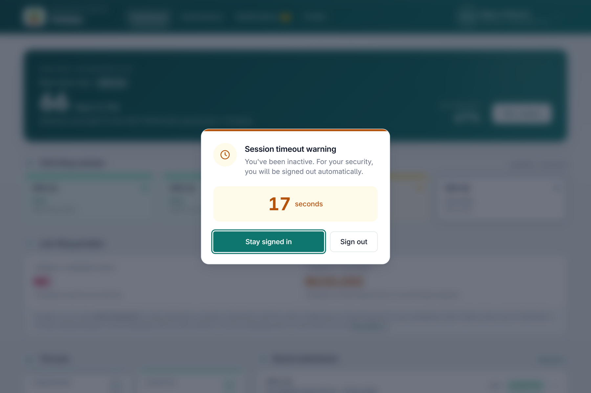

Only **Stay signed in** keeps the session; pressing Escape or clicking away does not. If you
return to a computer that has been idle for more than 16 minutes, you will already have been
signed out, with no warning. Sign in again.

> **Plan your filing around this.** A file you have analysed with the IRIS Upload Assistant
> but not yet approved is kept for **30 minutes**. If you are interrupted for longer, upload
> the file again.

### Getting around

The top bar carries four pages — **Dashboard · Submissions · Notifications · Profile**. The
Notifications item shows an amber count of unread messages. Your name and organisation open
a menu with **Upload photo** (or *Change photo*; an image up to 2 MB) and **Sign out**.

If your account is still waiting for you to set a password of your own, every page except
Profile is greyed out with a padlock and the tip *"Set a new password on the Profile page to
unlock"*.

---

## Part 3 — The dashboard

The dashboard is your home page: *am I keeping up, and what is due next?*

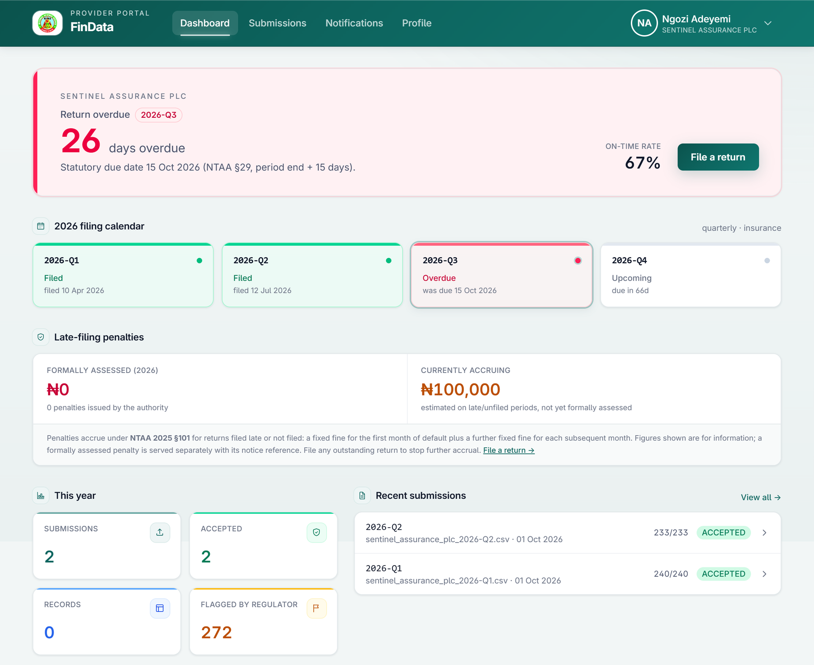

### The filing-obligation card

The large card at the top tells you the state of your next return:

| State | Colour | What it shows |
|---|---|---|
| **All returns up to date** | Teal | Nothing is due right now for the year |
| **Next return due** | Teal (15 days or more away) or amber (under 15 days) | The period, the number of days left, and the statutory due date |
| **Return overdue** | Rose | The period and how many days overdue it is |

The card also shows your **on-time rate** — the share of periods already due that you filed
on or before the due date — and a **File a return** button.

### Due dates

A return is **due 15 days after the last day of the period** (the portal prints the exact
date). For a quarterly filer that means:

| Period | Due |
|---|---|
| Q1 (January–March) | 15 April |
| Q2 (April–June) | 15 July |
| Q3 (July–September) | 15 October |
| Q4 (October–December) | 15 January |

> **File before the due date, not on it.** The system measures lateness from the very
> start of the due date (00:00 UTC, which is 01:00 in Nigeria). A return received at any
> time **on** the due date is recorded as **late**. Aim to file by the end of the day
> before.

You can only file for a period that **has ended**. The portal's period lists show ended
periods only, so the card can announce a due date for a period you cannot yet file.

### The filing calendar

One tile per period of the year, for your reporting frequency (four for quarterly, twelve
for monthly, one for annual):

| Tile | Meaning |
|---|---|
| **Filed** (green) | Your first accepted return for that period was received on or before the due date |
| **Filed late** (amber) | It was received after the due date |
| **Overdue** (rose) | Nothing has been accepted and the due date has passed |
| **Upcoming** (grey) | The due date has not yet arrived |

A **rejected** return does not count as filed. The period stays *Overdue* until a return is
accepted.

### Late-filing penalties

The panel shows two figures. **Formally assessed** is the total of penalties KIRS
has issued to you; **Currently accruing** is an estimate for late or unfiled periods that
have not yet been formally assessed. The penalty follows section 101 (Part 1): ₦100,000 for
the first month and ₦50,000 for each further month.

The portal counts months in **30-day blocks from the due date**, and a part-block counts as
a whole one:

| Days after the due date | Penalty |
|---|---|
| 1 to 30 | ₦100,000 |
| 31 to 60 | ₦150,000 |
| 61 to 90 | ₦200,000 |

A late return stops accruing on the day it was received; an unfiled one keeps accruing every
day until it is filed. **Filing the return stops the clock — it does not cancel a penalty
already assessed.** A formal penalty is served on you by KIRS, with a notice
reference, outside the portal; once issued it appears in the panel's table with its period,
the reason (*Not filed* or *Filed late*), the months and the amount.

### The four tiles and recent submissions

The tiles count **everything on record for your institution** (not only the current year):
submissions, accepted submissions, records, and **Flagged by regulator** — records that
KIRS's analysis has marked for review. **Recent submissions** lists your latest
five; each row opens that submission.

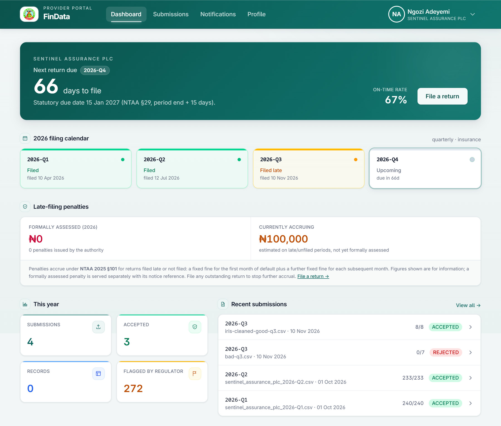

---

## Part 4 — Preparing your return

### Download the template

On **Submissions → New submission**, press **Download template**. Always start from the
current template: it names the columns exactly as the portal expects them, and it is
prepared for your institution and your reporting frequency.

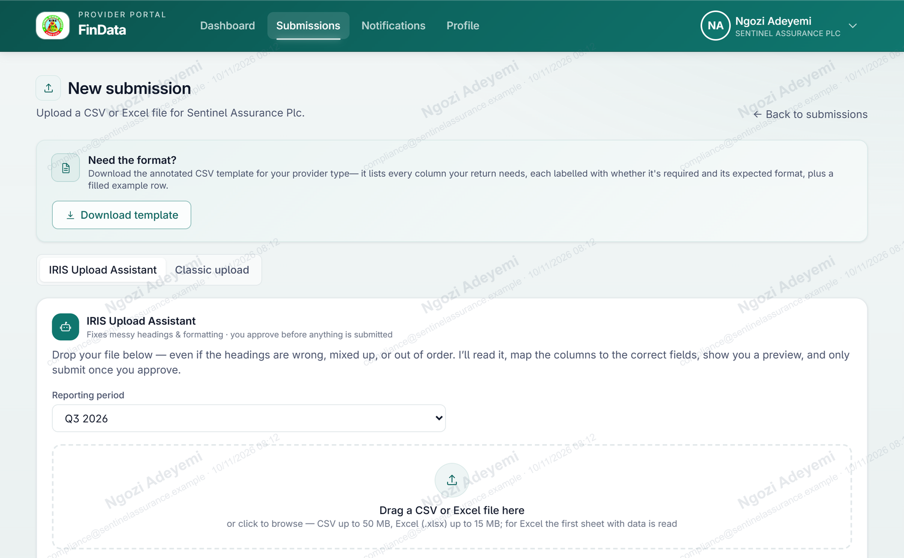

The file is named `bizdata-insurance-template.csv`. It opens with a block of guidance lines
that start with `#`; the portal ignores them on upload, so you may leave them in or delete
them. Beneath them are the **header row** and **one example row**:

```
nin,policyNumber,accountName,bvn,customerType,totalInflow,totalOutflow,tin
12345678901,POL/2026/000123,ADACHI VENTURES LTD,22212345678,PRIVATE_LIMITED,100000,50000,12345678-0001
```

> **Delete or replace the example row.** It looks like real data and, if left in, it is
> filed with your return.

### The eight columns

All are **compulsory except TIN**, and there is no grace period: a blank cell in a
compulsory column rejects the whole file.

| # | Column | Rule |
|---|---|---|
| 1 | `nin` | The National Identity Number — **exactly 11 digits**, digits only |
| 2 | `policyNumber` | The insurance policy number. Any length. Format the column as **Text** so leading zeros survive |
| 3 | `accountName` | The name of the policyholder |
| 4 | `bvn` | The Bank Verification Number — **exactly 11 digits**, digits only |
| 5 | `customerType` | One of the six values below |
| 6 | `totalInflow` | A plain number, **0 or more**: total credits for the period (₦) |
| 7 | `totalOutflow` | A plain number, **0 or more**: total debits for the period (₦) |
| 8 | `tin` | The Tax Identification Number — **optional**, but the strongest matching key the system has; send it wherever you hold one |

The reporting **period is not a column.** You choose it once when you upload and it is
applied to every row. Submit one file per period.

**Customer type** is `INDIVIDUAL` for a natural person. For an organisation it is the
Corporate Affairs Commission class:

| Value | Organisation |
|---|---|
| `INDIVIDUAL` | A natural person |
| `BUSINESS_NAME` | A sole proprietorship or partnership (BN) |
| `PRIVATE_LIMITED` | A private company (Ltd) |
| `PUBLIC_LIMITED` | A public company (Plc) |
| `LIMITED_BY_GUARANTEE` | A company limited by guarantee (Ltd/Gte) |
| `INCORPORATED_TRUSTEES` | Incorporated trustees (IT) |

The value is not case-sensitive, but it must be one of these six; `LTD` or `CORPORATE` is
rejected.

### Building the file

1. **Format identifier columns as Text first.** Set `nin`, `policyNumber`, `bvn` and `tin`
   to Text *before* you paste data. Otherwise the spreadsheet drops leading zeros and shows
   long numbers in scientific notation (`1.23457E+09`), and the digits are lost for good.
   A policy number or TIN in scientific notation is rejected.
2. **Write amounts as plain numbers.** `61900000` — not `61,900,000`, not `₦61900000`, not
   `(500)`. Use `0` where there was no inflow or no outflow, never a blank. Do not enter
   a negative number: report money out under `totalOutflow`.
3. **Keep the headings exactly as the template spells them,** including capital letters:
   `nin`, `policyNumber`, `accountName`, `bvn`, `customerType`, `totalInflow`,
   `totalOutflow`, `tin`. (The IRIS Upload Assistant tolerates different headings; the
   classic uploader does not — see Part 5.)
4. **Put the headings on the first line** of the file, apart from `#` guidance lines.
5. **One row per policy,** and **each policy number once** in the file. A repeat is
   rejected, and so is a policy number already filed for the same period in an earlier
   return.
6. **Save as CSV** (comma-separated). In Excel choose *File → Save As → CSV (Comma
   delimited)*; in LibreOffice choose *Text CSV*. An Excel workbook (`.xlsx`, up to 15 MB;
   the first sheet that has data is read) is also accepted. Older `.xls` and OpenDocument
   `.ods` files must be saved as CSV first — renaming them does not convert them.

### Before you upload — checklist

| ✓ | Check |
|---|---|
| ☐ | Started from the current template; example row removed |
| ☐ | Headings spelled exactly as in the template, on the first line |
| ☐ | `nin` and `bvn` are 11 digits, with no spaces, dashes or letters |
| ☐ | `policyNumber` and `tin` are Text; nothing in scientific notation |
| ☐ | Amounts are plain numbers ≥ 0, with `0` rather than blanks |
| ☐ | `customerType` is one of the six values |
| ☐ | Every compulsory cell is filled; every policy number appears once |
| ☐ | Only customers who meet the s.29(1) thresholds are included |
| ☐ | The period you will choose has ended |

---

## Part 5 — Filing the return

### Before you start

- The period must have **ended**. The portal offers ended periods only.
- Only **one submission per period** is accepted. A rejected file does not use up the
  period — you can upload again straight away — but once a return for the period has been
  accepted, a second one needs KIRS's authorisation (Part 6).
- Open **Submissions → + New submission**. Two tabs offer two ways to file:

| | IRIS Upload Assistant (default) | Classic upload |
|---|---|---|
| **Best when** | Your headings differ from the template, or you want a preview before anything is filed | Your file already follows the template exactly, or is very large |
| **Headings** | Matches them for you; you can change any match | Must be spelled exactly as the template |
| **Limits** | CSV up to 50 MB (60,000 rows); Excel up to 15 MB | CSV up to 100 MB; Excel up to 15 MB |
| **Period** | Choose from the last six ended quarters (twelve months, or three years) | Choose the year and the quarter (or month) |
| **Checks** | Shows every problem *before* you submit | Files and checks in one step |

### Filing with the IRIS Upload Assistant

**Step 1 — choose the period and the file.**
Open the *Reporting period* list — only ended periods appear, newest first, with the most
recent already selected — and drop your file on the panel, or click it to browse. The panel
accepts `.csv`, `.txt` and `.xlsx` files.

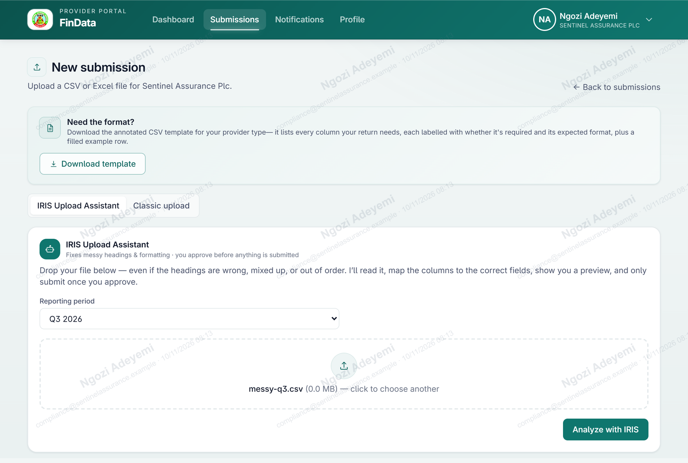

**Step 2 — press Analyze with IRIS.**
The Assistant reads the file, matches its columns to the return's fields, and shows what it
found. It **never invents a value**: it fixes structure and formatting only.

**Step 3 — review.**

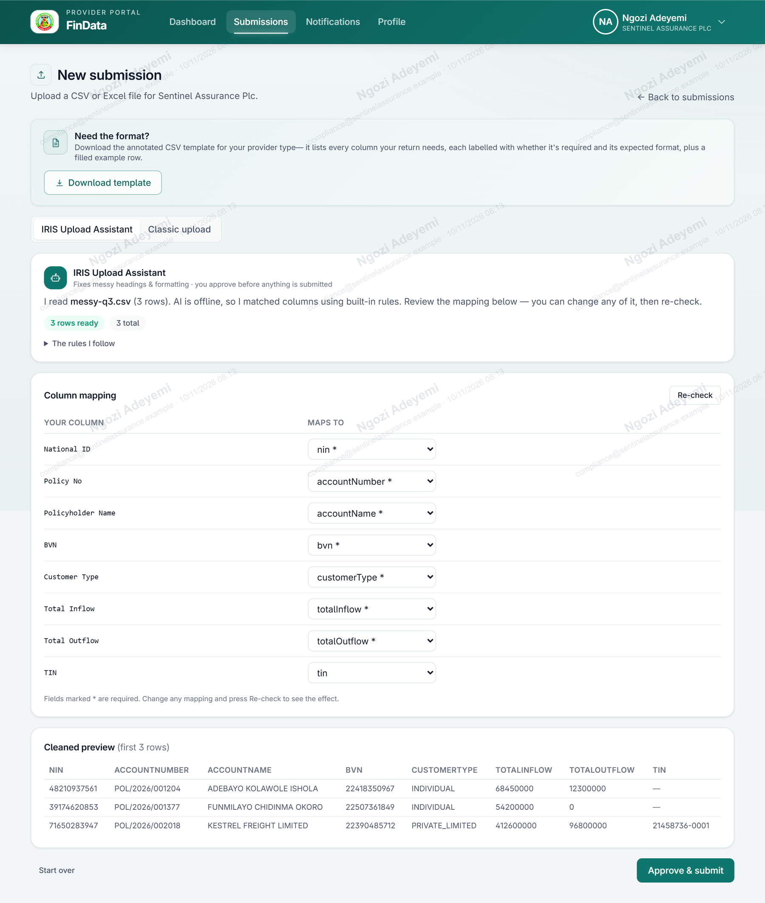

- The summary says how many rows it read and how it matched the columns. If it says
  *"AI is offline, so I matched columns using built-in rules"*, the matching used fixed rules
  instead of the AI model; the review steps and the checks are exactly the same.
- The green chip counts rows that are **ready**; a red chip counts rows that **need
  attention**.
- **The rules I follow** lists what will be enforced: your institution is eligible; the
  period must have ended; the required columns; that every row must be valid; and one
  submission per period.
- **Column mapping** shows *Your column → Maps to*. Fields marked `*` are compulsory. Change
  any match from the list (or choose *Ignore this column*) and press **Re-check**.
  A policy-number heading such as `policyNumber`, `Policy No` or `Policy Number` is matched
  to the policy-number field; a heading such as `Policyholder Name` is matched to the name.
- **Cleaned preview** shows the first rows as they will be filed — amounts stripped of
  currency signs and commas, dates and periods in standard form.
- **Rows I couldn't auto-fix** lists up to 30 rows that need a value the Assistant will not
  invent, with the reason. Here *Row N* means the **Nth data row, not counting the header**.
  Fix the file, upload it again — or correct the match — and press **Re-check**.

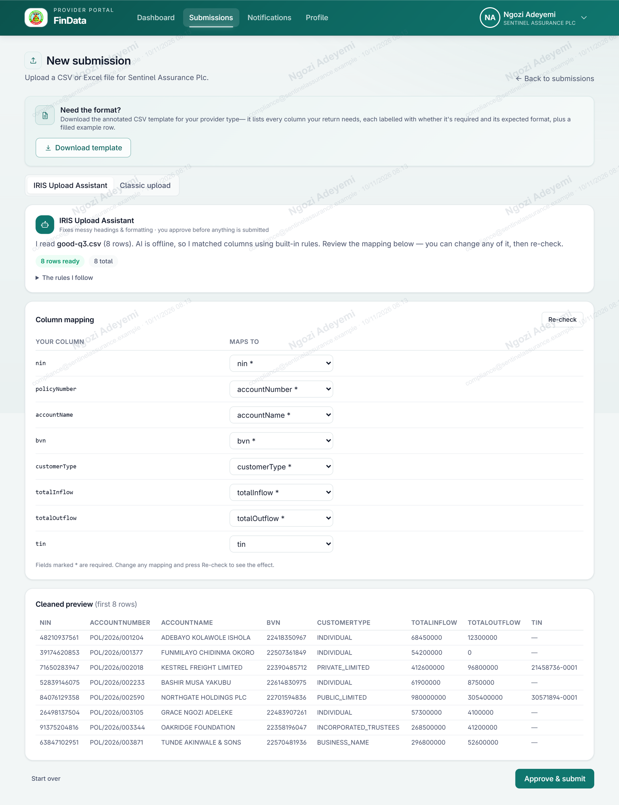

**Step 4 — Approve & submit.**
The button is enabled only when **no row needs attention**. Approving sends the cleaned file
through the same checks as the classic uploader and takes you to the submission's page.

Two things the Assistant cannot see before you approve: whether the period already has an
accepted return, and whether a policy number was already filed in an earlier return. Those
are checked on approval, and appear as a red message on the review screen.

### Filing with the classic upload

Choose **Classic upload**. Select the **Year** and the **Quarter** (or **Month**); the
**Period label** below them fills in by itself, for example `2026-Q3`. Check it before you
continue — it is the period your whole file will be filed under. Choose the file and press
**Upload submission**.

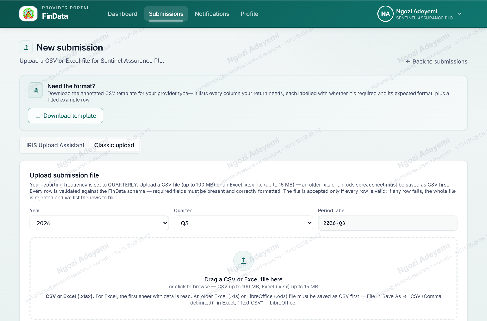

The result appears beneath the button:

| Result | Banner | Meaning |
|---|---|---|
| Accepted | **Submission received** (green) | Every row was valid and every record was stored |
| Rejected | **File rejected — no records were saved** (rose) | At least one row, or the file itself, failed; nothing was stored |
| Partly accepted | **Partially accepted — some rows were rejected** (amber) | Some rows stored, some rejected (Part 6) |

A green panel confirms that your data was sent over an encrypted connection and that every
sensitive field is encrypted on arrival, and shows the start of your receipt.

---

## Part 6 — After you submit

### Your submissions

**Submissions** lists every file you have uploaded, newest first, 25 to a page.

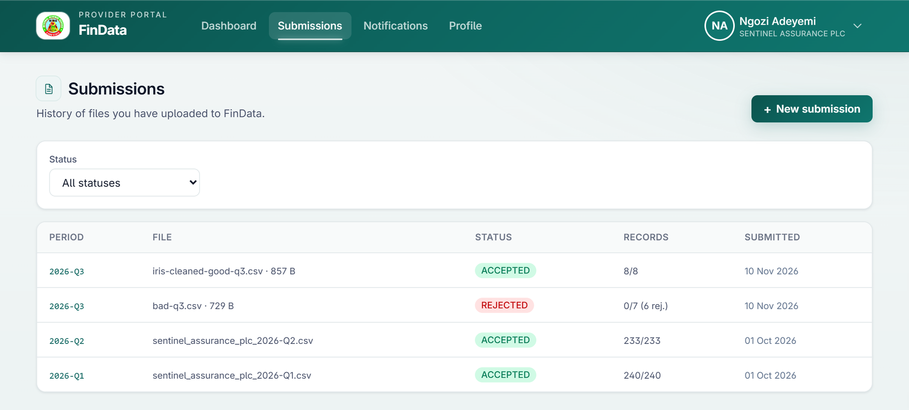

Each row shows the **period** (press it to open the submission), the **file** name and size,
the **status**, the **records** as *accepted/total* (with the number rejected in brackets),
and the date submitted. Use the **Status** filter to show only one status, and **+ New
submission** to file another. A rejected attempt stays in the list beside the accepted
return that followed it.

### Statuses

| Status | Meaning |
|---|---|
| **VALIDATING** | The file is being processed |
| **ACCEPTED** | Every row was valid; all records were stored |
| **PARTIALLY ACCEPTED** | Some rows were stored and some were rejected |
| **REJECTED** | No record was stored |

**Accepted and partly accepted returns count as filed** for the period. A rejected return
does not: the period stays *Overdue* until a return is accepted.

The **all-or-nothing rule**: a file is accepted only if every row is valid. If any row fails,
the whole file is rejected and the page lists the rows to fix.

### The submission page

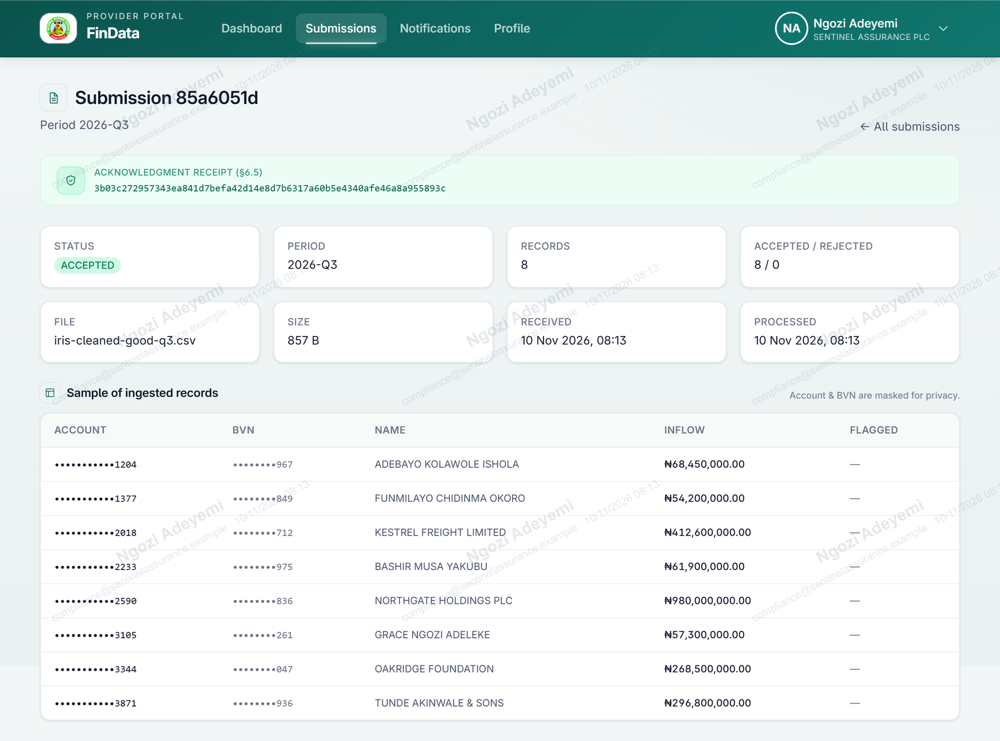

- **Acknowledgment receipt** — a 64-character code. It is your **proof of filing**: it is
  issued for every file received, including rejected ones. The portal has no download or
  copy button for it, so select the code and copy it, or save a screenshot, and keep it
  with your records.
- **Status, period, records, accepted/rejected, file, size, received, processed.**
- **Sample of ingested records** — see "The one-hour review window" below.

### The one-hour review window

For **one hour** after your file is received, the page shows a sample of up to **50** of the
records, masked: the policy number except its last four characters, the BVN except its last
three digits, the policyholder's name, the inflow, and a flag if KIRS has marked
the record for review. NIN, TIN and phone numbers are never shown.

After one hour the records are **sealed**: the page then reads *"This submission is now
sealed…"* and shows only the status, counts, any errors and the receipt. This is deliberate:
the portal holds no way to retrieve your data once it has been sent. **Keep your own copy of
every file you file.**

### Reading a rejection

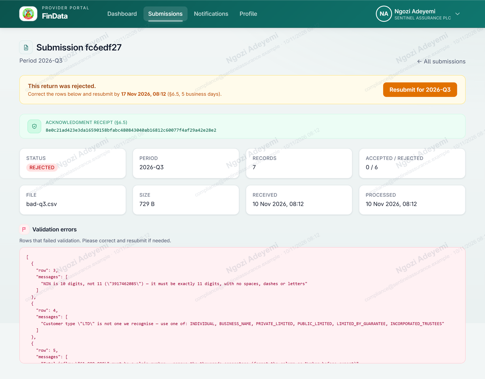

The banner reads *This return was rejected.* and gives a date by which to resubmit (five
business days). **Validation errors** lists each failed row as `row` (the **line number in the
file you uploaded**, with the header on line 1) and the `messages` explaining what is wrong.
Fix every line, then upload again. The messages you will meet most often:

| Message (abridged) | Cause | Fix |
|---|---|---|
| `NIN is 10 digits, not 11 ("…")` | A digit was dropped — often a leading zero lost in a spreadsheet | Re-export with the column formatted as Text; the value must be exactly 11 digits |
| `NIN contains something other than digits` | A space, dash or letter in the value | Remove it |
| `Customer type "LTD" is not one we recognise — use one of: …` | A value outside the six allowed | Use one of the six values in Part 4 |
| `Total inflow "61,900,000" must be a plain number — remove the thousands separators` | Commas in the amount | Format the column as Number and re-export |
| `… must be a plain number — remove the currency sign` | A ₦ sign in the amount | Remove it |
| `Total outflow … cannot be negative. Report money out under Total outflow, not as a negative inflow.` | A negative number | Use a positive figure in the right column |
| `Policy number "1.23457E+09" is in scientific notation — the original digits have been lost` | The spreadsheet converted the policy number | Re-key the column as Text and export again |
| `Account name is empty — enter the name on the account` | A blank compulsory cell | Fill it. Every compulsory column must have a value on every row |
| `This account is already reported on line 2 for 2026-Q3 …` | The same policy number twice in the file | Combine the rows or remove the repeat |
| `This account has already been submitted for 2026-Q3 in an earlier return …` | The policy number is already on record for that period | Remove the row (Part 6, "Corrections") |
| `Your file is missing a required column: …` | A heading is absent or misspelled | Copy the heading row from the template |
| `Rename "X" → nin` (and similar) | A heading is spelled differently | Spell it exactly as the template does |
| `…headings are on line N, but they must be the first line` | A title or date stamp above the headings | Delete the lines above the heading row (lines starting `#` may stay) |
| `…separates columns with semicolons (;)` | The wrong separator | Save as *CSV (Comma delimited)* |
| `NIN is empty` on **every** row, although the column is there | The heading's capital letters differ (`NIN`, `BVN`) | Use the template's lower-case headings exactly, or file through the Assistant |
| `This file is an Excel workbook, not a CSV` | An `.xls` or `.ods` file | Save as CSV; renaming does not convert |
| `… has not ended yet — a reporting period can only be submitted after it closes` | The period is still running | File after the last day of the period |
| `A submission for 2026-Q3 already exists. Data can only be submitted once per reporting period. To submit again for this period you need authorisation from the Tax Authority — please request a resubmission permission from KIRS.` | The period already has a return that was not rejected | Needs KIRS's authorisation (below) |

### Corrections

- **A rejected return:** correct the file and upload again at once. No permission is needed,
  and the rejected attempt does not count as your one submission for the period.
- **A return that was accepted:** a second return for the same period is refused until KIRS
  authorises it. KIRS grants a **one-time** authorisation for the
  period; you are notified (Part 8) and the notification links to the upload page. The
  authorisation is used up by the next upload for that period, whatever its result.
- **Policies already on record cannot be filed again.** A replacement file whose policy
  numbers are already on record for the period is rejected row by row with *"This account
  has already been submitted … in an earlier return"*, so a resubmission cannot change the
  figures of a policy that is already filed. If a figure on a filed policy was wrong, tell
  KIRS, quoting your receipt code; do not use up the authorisation on a file that
  will be rejected. A resubmission can add policies that were left out of the original
  return.

---

## Part 7 — Deadlines and penalties in practice

1. **Know your frequency.** It is on **Profile → Reporting frequency**.
2. **Work back from the due date** in Part 3. File at least a day early.
3. **Leave room for a rejection.** A rejected file does not file the period, and the clock
   keeps running: a corrected file received on the due date is recorded as late. File early
   enough to correct and file again before the due date begins.
4. **Watch the penalties panel.** *Currently accruing* is the estimate of what you are
   running up; filing stops it.
5. **A penalty notice is served on you outside the portal.** It carries a reference of the
   form `PPN-2026-Q3-…`, and the sum to be paid by a date stated in the notice. Questions
   about a notice are directed to KIRS, quoting its reference. The portal
   offers no screen for paying a penalty or disputing one.

---

## Part 8 — Notifications

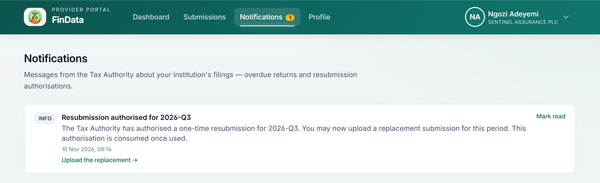

Messages from KIRS about your institution's filings appear under
**Notifications** (the portal's wording calls KIRS *the Tax Authority*), newest first. A severity tag (Info, Warning or Critical) marks each; press
**Mark read** to clear one. Each message may carry a link to the action it asks for.

| Message | When it appears | Link |
|---|---|---|
| **Overdue: 2026-Q3 data submission** (for the period concerned) | A period is overdue by more than 24 hours. One message per period; it is also e-mailed to your portal users, with the subject *[KIRS] Overdue: 2026-Q3 data submission*, when KIRS has e-mail set up | *File this return →* |
| **Resubmission authorised for 2026-Q3** (for the period concerned) | KIRS has authorised a one-time resubmission | *Upload the replacement →* |

The overdue message reads: *"Your 2026-Q3 data submission was due on … and is now overdue. Under §29 of the NTAA, financial institutions must report as required. Continued non-compliance may attract statutory penalties and enforcement action by the Kano State Internal Revenue Service. Please submit without further delay."*

Nothing is sent when a file is accepted or rejected — the result appears on screen — nor
when a penalty is issued, nor as a due date approaches. **The dashboard is your reminder.**

---

## Part 9 — Security and your data

| Protection | What it means for you |
|---|---|
| **Encrypted in transit** | Your file travels over an encrypted connection |
| **Encrypted at rest** | NIN, BVN, policy numbers, TIN and phone numbers are encrypted with AES-256 the moment they arrive |
| **Masked on screen** | You see a policy number's last four characters and a BVN's last three digits; there is **no way for a provider to reveal them** |
| **Not shown at all** | NIN, TIN and phone numbers never appear in the portal |
| **Sealed after an hour** | Your records disappear from the portal one hour after receipt; the receipt stays |
| **Viewer watermark** | The pages for new and filed submissions carry a faint watermark with your name, e-mail address and the time, so any photograph or screenshot identifies its source. If it is removed or hidden, the screen is covered, the event is recorded against your account, and you are signed out within seconds |
| **No shared passwords** | Nobody — including KIRS's staff — ever sees or sets your password |
| **Recorded sign-ins** | Every sign-in is written to a tamper-evident audit record |

**Your responsibilities.** Sign out when you leave your desk. Never share your password or an
invitation link. Keep a copy of every return and receipt. Treat the extract you prepare as
confidential personal data in your own systems, under the Nigeria Data Protection Act 2023.

---

## Part 10 — Your profile

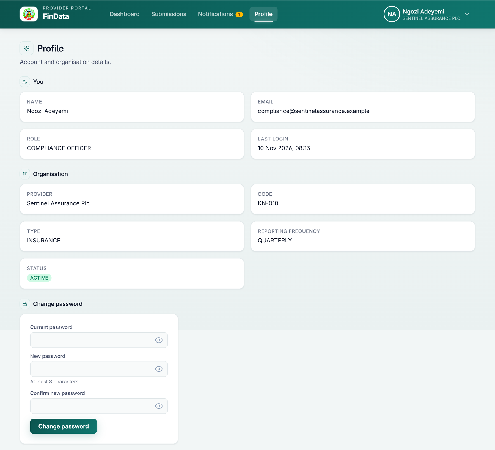

**You** shows your name, e-mail address, role and last sign-in. **Organisation** shows your
institution's name, **code**, **type** (INSURANCE), **reporting frequency** and **status**
(Active, Suspended or Pending onboarding). None of these can be edited here; the only
self-service items are your **password** and your **photo**. If a detail is wrong, ask your
KIRS to correct it.

---

## Appendix A — Trainer's quiz

| # | Question | Answer |
|---|---|---|
| 1 | Which Act and section names insurance companies as reporting institutions? | NTAA 2025, section 29(1) |
| 2 | Does FinData filter a file by the ₦50m / ₦250m thresholds? | No — apply them when you extract the data |
| 3 | When is a Q3 return due, and when is it late? | Due 15 October; anything received on 15 October or later is recorded as late |
| 4 | A file has `NIN` (capitals) as its heading. What happens in the classic uploader? | The column is found but every row reads *NIN is empty*, and the file is rejected |
| 5 | Can a rejected file be uploaded again? | Yes, at once, with no permission |
| 6 | You filed and the return was accepted. Can you file again for that period? | Only with KIRS's one-time authorisation |
| 7 | How long can you see your records after filing? | One hour; then they are sealed. The receipt stays |
| 8 | What penalty applies to a return 40 days late? | Two 30-day blocks: ₦100,000 + ₦50,000 = ₦150,000 |
| 9 | Why must `policyNumber` be formatted as Text? | Otherwise leading zeros are lost and long numbers become scientific notation, which is rejected |
| 10 | The Assistant says *1 row needs attention*. Can you approve? | No — Approve & submit stays disabled until no row needs attention |

## Appendix B — Practice files

These files hold invented data. Use them in a training installation.

| File | Purpose | Expected result |
|---|---|---|
| `good-q3.csv` | Eight valid rows with the template's own headings | Accepted: all 8 records |
| `messy-q3.csv` | Three valid rows under different headings (`National ID`, `Policy No`, `Policyholder Name`…) | The Assistant matches every heading; 3 rows ready |
| `bad-q3.csv` | Seven rows with six deliberate faults | Rejected: errors on lines 3 to 8 (a short NIN, `LTD`, a thousands separator, scientific notation, a blank name, a repeated policy number) |

The first line of `good-q3.csv`:

```
nin,policyNumber,accountName,bvn,customerType,totalInflow,totalOutflow,tin
48210937561,POL/2026/001204,ADEBAYO KOLAWOLE ISHOLA,22418350967,INDIVIDUAL,68450000,12300000,
```

Exercise: file `bad-q3.csv` for the Q3 period with the classic uploader and read the errors;
correct the file; then file `good-q3.csv` through the Assistant and press **Approve &
submit**. Compare the two submission pages.

## Appendix C — Quick reference

| Topic | Rule |
|---|---|
| **Sign in** | `/provider/login` · e-mail and password · 8 characters minimum |
| **Sessions** | 24 hours · warning after 15 minutes idle, 60 seconds to answer |
| **Template** | Submissions → New submission → Download template |
| **Columns** | `nin`, `policyNumber`, `accountName`, `bvn`, `customerType`, `totalInflow`, `totalOutflow`, `tin` (optional) |
| **Identifiers** | NIN and BVN: exactly 11 digits |
| **Amounts** | Plain numbers ≥ 0 · `0` for none |
| **Period** | Chosen on upload · must have ended · one accepted return per period |
| **Due date** | 15 days after the period ends · filing *on* the date is late |
| **Penalty (s.101)** | ₦100,000 first month; ₦50,000 each further month; 30-day blocks |
| **Receipt** | 64-character code on every submission page · copy it |
| **Review window** | 1 hour, then sealed |
| **Rejected** | Fix and upload again at once |
| **Accepted, needs correcting** | KIRS's one-time authorisation; replacement rows must have new policy numbers |

## Glossary

| Term | Meaning |
|---|---|
| **BVN** | Bank Verification Number — 11 digits |
| **NIN** | National Identification Number — 11 digits |
| **TIN** | Tax Identification Number |
| **CAC** | Corporate Affairs Commission — the register that classes organisations |
| **IRIS Upload Assistant** | The portal's guided uploader, which matches columns and previews the return before it is filed |
| **Return** | The file of one reporting period |
| **KIRS** | The Kano State Internal Revenue Service, the tax authority that receives your return — the portal's messages also call it *the Tax Authority* |
| **Sealed** | The state of a submission one hour after receipt: records hidden, receipt and counts kept |
| **Receipt** | The acknowledgment code issued for every file received |
